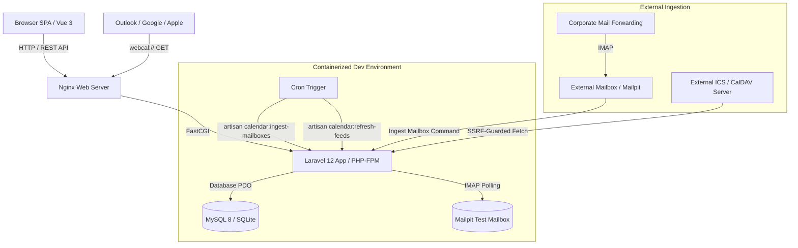
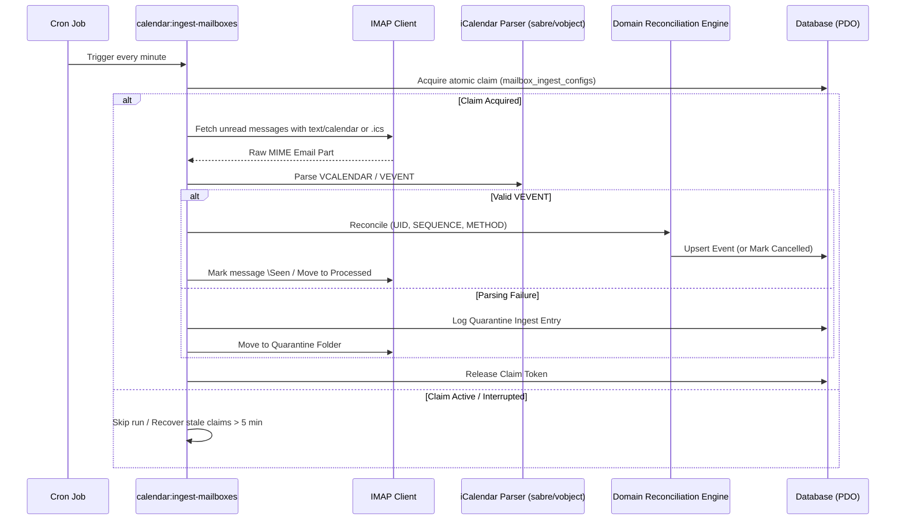

# Technical Design — Rendezvous MVP

## 1. System Architecture Diagram



## 2. Ingestion & Reconciliation Flow



## 3. Database Schema (MySQL & SQLite Compatible)

```sql
-- Tenants Table
CREATE TABLE tenants (
    id BIGINT AUTO_INCREMENT PRIMARY KEY,
    public_id VARCHAR(36) NOT NULL UNIQUE,
    name VARCHAR(255) NOT NULL,
    created_at TIMESTAMP DEFAULT CURRENT_TIMESTAMP,
    updated_at TIMESTAMP DEFAULT CURRENT_TIMESTAMP ON UPDATE CURRENT_TIMESTAMP
);

-- Calendars Table
CREATE TABLE calendars (
    id BIGINT AUTO_INCREMENT PRIMARY KEY,
    public_id VARCHAR(36) NOT NULL UNIQUE,
    tenant_id BIGINT NOT NULL,
    name VARCHAR(255) NOT NULL,
    color VARCHAR(32) NOT NULL DEFAULT '#6366f1',
    visibility_default BOOLEAN DEFAULT TRUE,
    created_at TIMESTAMP DEFAULT CURRENT_TIMESTAMP,
    updated_at TIMESTAMP DEFAULT CURRENT_TIMESTAMP ON UPDATE CURRENT_TIMESTAMP,
    FOREIGN KEY (tenant_id) REFERENCES tenants(id) ON DELETE CASCADE,
    INDEX idx_calendars_tenant (tenant_id)
);

-- Calendar Sources Table
CREATE TABLE calendar_sources (
    id BIGINT AUTO_INCREMENT PRIMARY KEY,
    public_id VARCHAR(36) NOT NULL UNIQUE,
    tenant_id BIGINT NOT NULL,
    calendar_id BIGINT NOT NULL,
    source_type VARCHAR(32) NOT NULL, -- 'email_mailbox', 'ics_feed', 'caldav'
    config_json TEXT NULL,
    secret_ref VARCHAR(255) NULL,
    last_synced_at TIMESTAMP NULL,
    last_sync_state VARCHAR(32) DEFAULT 'idle',
    created_at TIMESTAMP DEFAULT CURRENT_TIMESTAMP,
    updated_at TIMESTAMP DEFAULT CURRENT_TIMESTAMP ON UPDATE CURRENT_TIMESTAMP,
    FOREIGN KEY (tenant_id) REFERENCES tenants(id) ON DELETE CASCADE,
    FOREIGN KEY (calendar_id) REFERENCES calendars(id) ON DELETE CASCADE,
    INDEX idx_sources_tenant_sync (tenant_id, source_type, last_synced_at)
);

-- Mailbox Ingest Configs Table
CREATE TABLE mailbox_ingest_configs (
    id BIGINT AUTO_INCREMENT PRIMARY KEY,
    tenant_id BIGINT NOT NULL,
    source_id BIGINT NOT NULL,
    imap_host VARCHAR(255) NOT NULL,
    imap_port INT NOT NULL DEFAULT 993,
    folder VARCHAR(255) NOT NULL DEFAULT 'INBOX',
    secret_ref VARCHAR(255) NOT NULL,
    claim_token VARCHAR(64) NULL,
    claimed_at TIMESTAMP NULL,
    claim_expires_at TIMESTAMP NULL,
    created_at TIMESTAMP DEFAULT CURRENT_TIMESTAMP,
    updated_at TIMESTAMP DEFAULT CURRENT_TIMESTAMP ON UPDATE CURRENT_TIMESTAMP,
    FOREIGN KEY (tenant_id) REFERENCES tenants(id) ON DELETE CASCADE,
    FOREIGN KEY (source_id) REFERENCES calendar_sources(id) ON DELETE CASCADE,
    INDEX idx_mailbox_claims (claim_expires_at)
);

-- Events Table
CREATE TABLE events (
    id BIGINT AUTO_INCREMENT PRIMARY KEY,
    public_id VARCHAR(36) NOT NULL UNIQUE,
    tenant_id BIGINT NOT NULL,
    calendar_id BIGINT NOT NULL,
    uid VARCHAR(255) NOT NULL,
    sequence INT NOT NULL DEFAULT 0,
    recurrence_id VARCHAR(255) NULL,
    method_origin VARCHAR(32) NOT NULL DEFAULT 'REQUEST',
    organizer_json TEXT NULL,
    attendees_json TEXT NULL,
    summary VARCHAR(500) NOT NULL,
    description TEXT NULL,
    location VARCHAR(500) NULL,
    dtstart_utc DATETIME NOT NULL,
    dtend_utc DATETIME NOT NULL,
    tzid_original VARCHAR(100) NOT NULL DEFAULT 'UTC',
    rrule TEXT NULL,
    exdates_json TEXT NULL,
    status VARCHAR(32) NOT NULL DEFAULT 'confirmed', -- 'confirmed', 'cancelled', 'tentative'
    source_type VARCHAR(32) NOT NULL, -- 'email_invite', 'ics_feed_subscription', 'caldav_subscription', 'manual'
    raw_vevent_hash VARCHAR(64) NULL,
    created_at TIMESTAMP DEFAULT CURRENT_TIMESTAMP,
    updated_at TIMESTAMP DEFAULT CURRENT_TIMESTAMP ON UPDATE CURRENT_TIMESTAMP,
    FOREIGN KEY (tenant_id) REFERENCES tenants(id) ON DELETE CASCADE,
    FOREIGN KEY (calendar_id) REFERENCES calendars(id) ON DELETE CASCADE,
    UNIQUE KEY uq_event_uid (tenant_id, calendar_id, uid, recurrence_id),
    INDEX idx_events_lookup (tenant_id, calendar_id, dtstart_utc)
);

-- Secrets Table (Encrypted at rest)
CREATE TABLE secrets (
    id BIGINT AUTO_INCREMENT PRIMARY KEY,
    tenant_id BIGINT NOT NULL,
    secret_key VARCHAR(255) NOT NULL,
    encrypted_value TEXT NOT NULL,
    created_at TIMESTAMP DEFAULT CURRENT_TIMESTAMP,
    updated_at TIMESTAMP DEFAULT CURRENT_TIMESTAMP ON UPDATE CURRENT_TIMESTAMP,
    FOREIGN KEY (tenant_id) REFERENCES tenants(id) ON DELETE CASCADE,
    UNIQUE KEY uq_secret_key (tenant_id, secret_key)
);
```

## 4. Outlook 365 & Google Workspace Feed Conformance Specification
The `FeedExportService` MUST observe the following rules when building `webcal://` responses:
1. **Single `VCALENDAR` Block:** Output MUST contain exactly one `BEGIN:VCALENDAR` ... `END:VCALENDAR` wrapper containing all merged `VEVENT` items.
2. **Top-Level `METHOD` Omission:** MUST NOT set `METHOD:PUBLISH` or `METHOD:REQUEST` at the top level to avoid Outlook treating the feed as a single event object instead of a folder.
3. **Required Headers:** MUST include `X-WR-CALNAME:<Calendar Name>` and `X-WR-TIMEZONE:<Timezone>`.
4. **Valid `VEVENT` Attributes:** Every `VEVENT` MUST contain `UID`, `DTSTAMP`, `DTSTART`, and either `DTEND` or `DURATION` (never both).
